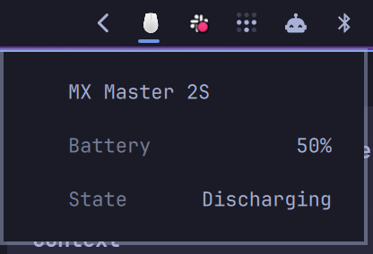

# MX Master 2S battery for Omarchy

Show the battery level and charging state of a Logitech MX Master 2S in the Omarchy tray. Hover over the mouse icon in the tray drawer to see the battery information.



The plugin uses Solaar if it is installed and can read the mouse. It retries failed Solaar reads up to three times, with two seconds between attempts. If all attempts fail, it uses UPower and Linux battery data. UPower can mark its percentage as unreliable, so treat it as an estimate.

## Requirements

- Omarchy 4.0.6-1. The tray widget is based on the tray from this version.
- UPower, Python, PyGObject, GTK 3, and Ayatana AppIndicator.
- A connected Logitech MX Master 2S.
- Optional: Solaar, with permission to access the Logitech receiver.

## Install

```bash
omarchy plugin add https://github.com/prasetiady/omarchy-mx-master-battery.git --enable
```

The plugin replaces the built-in tray widget with a customized copy and starts the indicator while the plugin is enabled. It preserves the built-in tray's pinned and hidden settings. Existing tray clones and customizations are not merged.

If you previously installed the standalone indicator from `omarchy-plugins`, stop its service before enabling this plugin to avoid running two indicators:

```bash
systemctl --user disable --now mx-master-battery-tray.service
```

## Remove

Disable the plugin with `omarchy plugin disable prasetiady.mx-master-battery` to restore the built-in tray, then remove it with `omarchy plugin remove prasetiady.mx-master-battery`.
